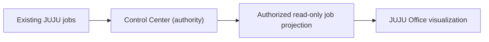

# JUJU OFFICE — Living Automation Studio

An expressive, browser-based 2.5D virtual software studio that turns real automation work into a navigable office scene. The design follows the approved high-detail isometric reference, with glass meeting rooms, warm lighting, workstation clusters, and ten independently selectable visual roles.


> **Status (2026-11-25):** An interactive **vertical slice** with a JUJU Mini host-side route now verified at [http://auto.juju-mini.local/office/](http://auto.juju-mini.local/office/). NPM returns HTTP 200 for the page and assets while the existing Control Center root and protected API remain intact. **This is not yet a fully accepted production release**: a signed-in LAN browser, exact live worker alignment, restart persistence, and final animation fidelity still need acceptance. The public demonstration uses **synthetic demo data only**.

## Experience

- Explore a panoramic 2.5D office, pan/zoom, click any character, or search to locate a role.
- View a selected worker's task, current state, department, project, pipeline and job reference in the inspector.
- Filter the scene by project. Browse Tasks, Automation, Projects, Reports and the activity feed.
- Switch between an explicitly labeled synthetic **DEMO** and read-only **LIVE** mode. LIVE never fabricates current activity; unauthenticated or unavailable job data shows a disconnected state. The portfolio/other hosts start in DEMO; only `auto.juju-mini.local/office/` automatically attempts LIVE using the existing JUJU session and a conservative authenticated jobs API fallback while the private adapter is absent.
- Includes Project Manager, Team Lead, Senior Developer, Developer, Creative Designer, QA Engineer, DevOps Engineer, Business Analyst, **Content Writer**, and **Social Media Specialist**.

## Start the preview

Requires Node.js 20+; no package download or npm dependencies are needed.

```bash
npm test
npm run check
npm start
```

Open `http://127.0.0.1:4381/` from the machine running the app. It binds to loopback by default. `HOST=0.0.0.0` is intended only behind the approved reverse proxy or in a controlled development network.

`compose.yaml` prepares a separately stoppable web service attached to the existing external Docker network `npm_proxy` — **Nginx Proxy Manager**, not the npm package registry. It has no public port binding. No Docker deployment or DNS modification is performed by this repository.

For the space-constrained `juju-mini` host, a lower-footprint alternative is included under `deploy/`: a systemd unit template using an integrity-checked, version-pinned copy of the already-installed Node executable on the external JUJU work volume. It remains capped at **128 MB memory and 12% CPU**, protects home directories, and listens only on the Docker `npm_proxy` bridge gateway. It is installed and configured **only** through a separately approved JUJU deployment job. See the private deployment runbook; do not apply it on arbitrary hosts.

Because an actual JUJU deployment proved that NPM's container could not reach the host-bridge-bound service, `deploy/install-sidecar.sh` provides a second, safer NPM-visible option. It reuses the **exact cached image ID** already running Nginx Proxy Manager, only as a Node runtime for a separately named, read-only web container; it performs **no image pull or build**. This tiny sidecar has **128 MB / 0.12 CPU** limits, no host-published port, no access to NPM configuration/data, a read-only public source mount, bounded NPM-to-sidecar health checks, and its own rollback. It deliberately does **not** configure or publish an NPM route. Deploy it only through a separately approved JUJU Job.

## How live work will connect

The virtual staff are stage/role representations of JUJU Jobs, not ten literal human employees or ten independent execution agents.



The planned same-origin, authenticated `api/office/v1/snapshot` adapter implements `docs/EVENT_CONTRACT.md` but is **not yet deployed** (its placeholder returns HTTP 501). On the requested `auto.juju-mini.local/office/` URL, the working UI can instead read the existing Control Center `/api/v1/jobs` endpoint under the operator's existing session and `jobs.view` authorization. The mapping is conservative and read-only: stale, uncertain or unauthorized jobs cannot be presented as active workers. Signed-in LAN validation is still pending. No secret tokens or private client records belong in this public repository.

## Project documentation

- [End-to-end plan](docs/PROJECT_PLAN.md)
- [Binding visual specification](docs/VISUAL_SPEC.md)
- [Event and role mapping](docs/EVENT_CONTRACT.md)
- [Frontend snapshot API contract](docs/SNAPSHOT_API.md)
- [Portfolio and privacy](docs/SECURITY_AND_DEMO.md)
- [Interactive implementation and limitations](docs/APP_IMPLEMENTATION.md)
- [Work log](docs/WORK_LOG.md)
- [Project epic](https://github.com/thesoledev-public/juju-virtual-office/issues/9)

Future milestones include final character movement and furniture occlusion, richer authenticated job snapshots, LAN client DNS/browser and session acceptance, proxy regeneration checks, and a measured resource budget that does not slow existing JUJU tasks.
